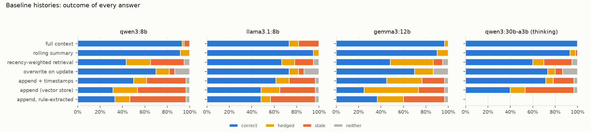
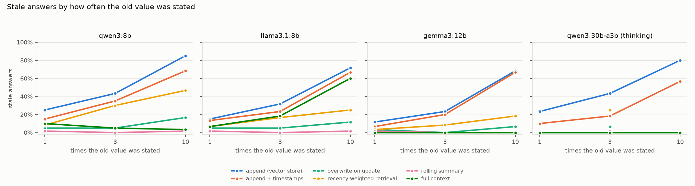
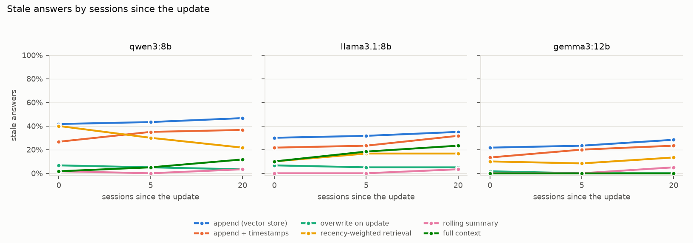
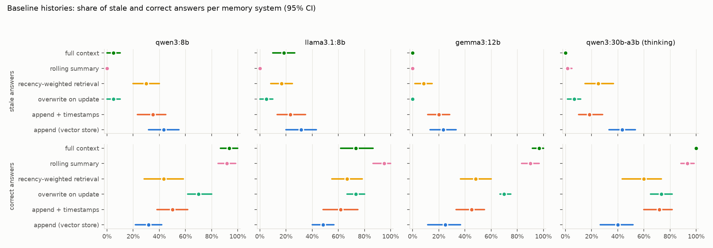
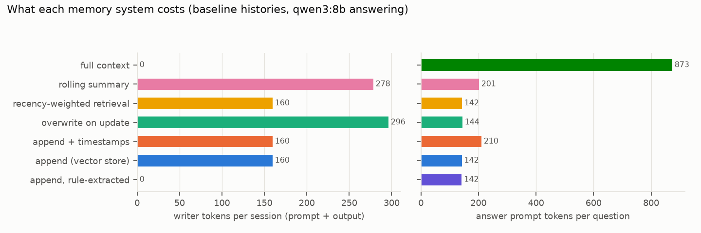

# Results

Generated by `uv run memrot report` from the cached runs in `results/`. Every number below comes from that code. Intervals are 95% percentile bootstrap intervals that resample users (each user is one history family with six probed facts), 2000 draws. pp = percentage points.

## Runs

| answering model | digest | users | answers | conditions | systems |
|---|---|---|---|---|---|
| qwen3:8b | 500a1f067a9f | 10 | 3360 | base, rep1, rep10, gap0, gap20, implied, chain2, aa | a_rule, a, b, c, d, e, f |
| llama3.1:8b | 46e0c10c039e | 10 | 3360 | base, rep1, rep10, gap0, gap20, implied, chain2, aa | a_rule, a, b, c, d, e, f |
| gemma3:12b | b92b218582c5 | 10 | 3360 | base, rep1, rep10, gap0, gap20, implied, chain2, aa | a_rule, a, b, c, d, e, f |
| qwen3:30b-a3b | ad815644918f | 10 | 900 | base, rep1, rep10, aa | a, b, c, d, e, f |

`qwen3:30b-a3b` is the thinking-only Qwen3 release in this Ollama install: `think: false` does not stop its reasoning, so it runs with `think: true` and `num_predict` 2048, and only its final answer is judged. It is a reasoning model here, unlike the other three. Answers cut off by the length cap: 5 of 900. Its grid is smaller (time).

Model calls in the cache (including the excluded pilot users), with server compute time and wall time per call summed (wall time includes queueing behind the other workload sharing the GPU):

| model | calls | compute hours | wall hours |
|---|---|---|---|
| gemma3:12b | 3468 | 3.30 | 6.94 |
| llama3.1:8b | 3468 | 2.32 | 4.66 |
| qwen3:30b-a3b | 899 | 1.59 | 3.20 |
| qwen3:8b | 9010 | 5.44 | 11.67 |

Writer (memory extraction, overwrite decisions, summaries) for every store: `qwen3:8b`. Options for every call: `{"temperature": 0, "seed": 7, "num_ctx": 8192}` plus a per-call `num_predict` (`{"extract": 120, "overwrite": 16, "summary": 160, "answer": 80}`). `think: false` is sent to qwen3:8b (and `think: true` to the thinking-only qwen3:30b-a3b, see above); other models get no think field. Embeddings: `BAAI/bge-small-en-v1.5`. Retrieval k = 5 unless stated.

## Headline numbers

Stale rate (share of questions answered with an old value), 95% CI over users. Append = the plain append-only vector store (system a).

| model | append, base | append, stated 1x | append, stated 10x | append, gap 0 | append, gap 20 | timestamps | overwrite | recency | summary | full context | full context, implied update |
|---|---|---|---|---|---|---|---|---|---|---|---|
| qwen3:8b | 43% [32%, 55%] | 25% [17%, 32%] | 85% [77%, 93%] | 42% [30%, 53%] | 47% [37%, 58%] | 35% [23%, 45%] | 5% [0%, 10%] | 30% [20%, 40%] | 0% [0%, 0%] | 5% [0%, 10%] | 72% [62%, 82%] |
| llama3.1:8b | 32% [20%, 43%] | 15% [7%, 23%] | 72% [63%, 82%] | 30% [17%, 43%] | 35% [25%, 47%] | 23% [13%, 35%] | 5% [0%, 10%] | 17% [8%, 25%] | 0% [0%, 0%] | 18% [10%, 27%] | 90% [83%, 97%] |
| gemma3:12b | 23% [13%, 33%] | 12% [5%, 18%] | 68% [58%, 78%] | 22% [12%, 32%] | 28% [18%, 38%] | 20% [12%, 28%] | 0% [0%, 0%] | 8% [2%, 15%] | 0% [0%, 0%] | 0% [0%, 0%] | 25% [13%, 38%] |
| qwen3:30b-a3b | 43% [33%, 53%] | 23% [12%, 37%] | 80% [73%, 88%] | n/a | n/a | 18% [10%, 28%] | 7% [2%, 12%] | 25% [15%, 37%] | 2% [0%, 5%] | 0% [0%, 0%] | n/a |

## 1. Baseline: which answer comes back?

Baseline histories: each old value stated 3 times, one explicit update, 5 sessions between the update and the question.

**qwen3:8b**

| memory | correct | stale | hedged | neither | mentions change | n |
|---|---|---|---|---|---|---|
| append, rule-extracted | 33% [22%, 43%] | 50% [38%, 62%] | 13% | 3% | 17% | 60 |
| append (vector store) | 32% [22%, 42%] | 43% [32%, 55%] | 22% | 3% | 22% | 60 |
| append + timestamps | 50% [38%, 62%] | 35% [23%, 45%] | 12% | 3% | 35% | 60 |
| overwrite on update | 70% [62%, 80%] | 5% [0%, 10%] | 12% | 13% | 27% | 60 |
| recency-weighted retrieval | 43% [28%, 58%] | 30% [20%, 40%] | 22% | 5% | 23% | 60 |
| rolling summary | 92% [85%, 98%] | 0% [0%, 0%] | 8% | 0% | 20% | 60 |
| full context | 93% [87%, 100%] | 5% [0%, 10%] | 2% | 0% | 43% | 60 |

**llama3.1:8b**

| memory | correct | stale | hedged | neither | mentions change | n |
|---|---|---|---|---|---|---|
| append, rule-extracted | 48% [32%, 63%] | 40% [27%, 55%] | 8% | 3% | 40% | 60 |
| append (vector store) | 48% [40%, 57%] | 32% [20%, 43%] | 17% | 3% | 47% | 60 |
| append + timestamps | 62% [48%, 75%] | 23% [13%, 35%] | 12% | 3% | 45% | 60 |
| overwrite on update | 73% [67%, 80%] | 5% [0%, 10%] | 8% | 13% | 35% | 60 |
| recency-weighted retrieval | 67% [55%, 78%] | 17% [8%, 25%] | 12% | 5% | 45% | 60 |
| rolling summary | 95% [87%, 100%] | 0% [0%, 0%] | 5% | 0% | 28% | 60 |
| full context | 73% [62%, 87%] | 18% [10%, 27%] | 8% | 0% | 63% | 60 |

**gemma3:12b**

| memory | correct | stale | hedged | neither | mentions change | n |
|---|---|---|---|---|---|---|
| append, rule-extracted | 37% [22%, 53%] | 37% [27%, 48%] | 23% | 3% | 62% | 60 |
| append (vector store) | 25% [12%, 37%] | 23% [13%, 33%] | 48% | 3% | 53% | 60 |
| append + timestamps | 45% [33%, 55%] | 20% [12%, 28%] | 32% | 3% | 57% | 60 |
| overwrite on update | 70% [67%, 75%] | 0% [0%, 0%] | 17% | 13% | 52% | 60 |
| recency-weighted retrieval | 48% [37%, 60%] | 8% [2%, 15%] | 38% | 5% | 55% | 60 |
| rolling summary | 90% [83%, 97%] | 0% [0%, 0%] | 10% | 0% | 52% | 60 |
| full context | 97% [92%, 100%] | 0% [0%, 0%] | 3% | 0% | 98% | 60 |

**qwen3:30b-a3b**

| memory | correct | stale | hedged | neither | mentions change | n |
|---|---|---|---|---|---|---|
| append (vector store) | 40% [27%, 52%] | 43% [33%, 53%] | 13% | 3% | 37% | 60 |
| append + timestamps | 72% [60%, 82%] | 18% [10%, 28%] | 7% | 3% | 37% | 60 |
| overwrite on update | 73% [65%, 82%] | 7% [2%, 12%] | 7% | 13% | 27% | 60 |
| recency-weighted retrieval | 60% [43%, 73%] | 25% [15%, 37%] | 10% | 5% | 38% | 60 |
| rolling summary | 93% [88%, 98%] | 2% [0%, 5%] | 5% | 0% | 28% | 60 |
| full context | 100% [100%, 100%] | 0% [0%, 0%] | 0% | 0% | 72% | 60 |

## 2. Noise floor

Two A/A comparisons. **Rewording**: the baseline design regenerated with a different phrasing seed and filler draw (same users, same values, same schedule); every effect below is compared with this gap. **Rerun**: the baseline questions asked again with the cache bypassed (same prompts, same seed), which measures server nondeterminism at temperature 0.

| model | memory | rewording gap, stale | rewording gap, correct | rerun |
|---|---|---|---|---|
| qwen3:8b | append, rule-extracted | -5 pp [-20, +10] | +8 pp [-3, +20] | 0% answers differ, 0% outcomes differ |
| qwen3:8b | append (vector store) | +10 pp [-7, +27] | -7 pp [-23, +12] | 0% answers differ, 0% outcomes differ |
| qwen3:8b | append + timestamps | -3 pp [-18, +13] | +7 pp [-10, +22] | 0% answers differ, 0% outcomes differ |
| qwen3:8b | overwrite on update | +7 pp [-3, +18] | -3 pp [-13, +7] | 0% answers differ, 0% outcomes differ |
| qwen3:8b | recency-weighted retrieval | -3 pp [-22, +13] | +2 pp [-25, +30] | 0% answers differ, 0% outcomes differ |
| qwen3:8b | rolling summary | +0 pp [+0, +0] | -7 pp [-18, +5] | 0% answers differ, 0% outcomes differ |
| qwen3:8b | full context | +0 pp [-5, +5] | -7 pp [-15, +2] | 0% answers differ, 0% outcomes differ |
| llama3.1:8b | append, rule-extracted | -3 pp [-22, +12] | +5 pp [-12, +25] | n/a |
| llama3.1:8b | append (vector store) | +3 pp [-13, +23] | +2 pp [-13, +17] | n/a |
| llama3.1:8b | append + timestamps | +8 pp [-10, +28] | -3 pp [-27, +20] | n/a |
| llama3.1:8b | overwrite on update | +5 pp [-2, +12] | -5 pp [-12, +2] | n/a |
| llama3.1:8b | recency-weighted retrieval | -3 pp [-17, +10] | -3 pp [-18, +15] | n/a |
| llama3.1:8b | rolling summary | +0 pp [+0, +0] | -7 pp [-17, +2] | n/a |
| llama3.1:8b | full context | -3 pp [-17, +12] | +8 pp [-10, +27] | n/a |
| gemma3:12b | append, rule-extracted | +0 pp [-17, +13] | +3 pp [-13, +22] | n/a |
| gemma3:12b | append (vector store) | +8 pp [-10, +27] | +8 pp [-13, +30] | n/a |
| gemma3:12b | append + timestamps | +5 pp [-12, +23] | +5 pp [-17, +28] | n/a |
| gemma3:12b | overwrite on update | +7 pp [+2, +12] | -7 pp [-15, +2] | n/a |
| gemma3:12b | recency-weighted retrieval | +5 pp [-10, +20] | -3 pp [-20, +15] | n/a |
| gemma3:12b | rolling summary | +0 pp [+0, +0] | -8 pp [-18, +2] | n/a |
| gemma3:12b | full context | +0 pp [+0, +0] | -10 pp [-17, -3] | n/a |
| qwen3:30b-a3b | append (vector store) | +5 pp [-15, +25] | -2 pp [-20, +17] | n/a |
| qwen3:30b-a3b | append + timestamps | +3 pp [-12, +18] | +3 pp [-13, +18] | n/a |
| qwen3:30b-a3b | full context | +0 pp [+0, +0] | -10 pp [-15, -5] | n/a |

## Primary contrasts (fixed in HYPOTHESES.md)

Stale rate. Repetition: 10 statements minus 1. Recency: 20 sessions since the update minus 0. Paired by user and attribute.

| model | memory | rep10 minus rep1 | gap20 minus gap0 | A/A gap |
|---|---|---|---|---|
| qwen3:8b | append, rule-extracted | +48 pp [+33, +63] * | +3 pp [-3, +10] | -5 pp [-20, +10] |
| qwen3:8b | append (vector store) | +60 pp [+48, +73] * | +5 pp [+0, +10] | +10 pp [-7, +27] |
| qwen3:8b | append + timestamps | +53 pp [+45, +63] * | +10 pp [+3, +17] * | -3 pp [-18, +13] |
| qwen3:8b | overwrite on update | +12 pp [-2, +25] | -3 pp [-7, +0] | +7 pp [-3, +18] |
| qwen3:8b | recency-weighted retrieval | +38 pp [+27, +50] * | -18 pp [-30, -5] * | -3 pp [-22, +13] |
| qwen3:8b | rolling summary | +0 pp [-5, +5] | +2 pp [-3, +7] | +0 pp [+0, +0] |
| qwen3:8b | full context | -7 pp [-13, +0] | +10 pp [+3, +17] * | +0 pp [-5, +5] |
| llama3.1:8b | append, rule-extracted | +48 pp [+38, +58] * | +2 pp [+0, +5] | -3 pp [-22, +12] |
| llama3.1:8b | append (vector store) | +57 pp [+48, +65] * | +5 pp [+0, +10] | +3 pp [-13, +23] |
| llama3.1:8b | append + timestamps | +53 pp [+42, +63] * | +10 pp [+3, +17] * | +8 pp [-10, +28] |
| llama3.1:8b | overwrite on update | +7 pp [-5, +18] | -2 pp [-5, +0] | +5 pp [-2, +12] |
| llama3.1:8b | recency-weighted retrieval | +18 pp [+12, +25] * | +7 pp [-2, +17] | -3 pp [-17, +10] |
| llama3.1:8b | rolling summary | +0 pp [-5, +5] | +3 pp [+0, +8] | +0 pp [+0, +0] |
| llama3.1:8b | full context | +53 pp [+38, +70] * | +13 pp [+2, +25] * | -3 pp [-17, +12] |
| gemma3:12b | append, rule-extracted | +48 pp [+40, +58] * | +3 pp [+0, +8] | +0 pp [-17, +13] |
| gemma3:12b | append (vector store) | +57 pp [+43, +68] * | +7 pp [+2, +12] | +8 pp [-10, +27] |
| gemma3:12b | append + timestamps | +60 pp [+53, +68] * | +10 pp [+3, +17] * | +5 pp [-12, +23] |
| gemma3:12b | overwrite on update | +3 pp [-2, +10] | -2 pp [-5, +0] | +7 pp [+2, +12] |
| gemma3:12b | recency-weighted retrieval | +15 pp [+8, +22] * | +3 pp [-5, +10] | +5 pp [-10, +20] |
| gemma3:12b | rolling summary | -2 pp [-5, +0] | +5 pp [+2, +10] * | +0 pp [+0, +0] |
| gemma3:12b | full context | +0 pp [+0, +0] | +0 pp [+0, +0] | +0 pp [+0, +0] |
| qwen3:30b-a3b | append (vector store) | +57 pp [+45, +68] * | n/a | +5 pp [-15, +25] |
| qwen3:30b-a3b | append + timestamps | +47 pp [+35, +60] * | n/a | +3 pp [-12, +18] |
| qwen3:30b-a3b | full context | +0 pp [+0, +0] | n/a | +0 pp [+0, +0] |

## 3. Repetition: how often the old value was stated

Old value stated 1, 3 (base) or 10 times before the update; everything else as base.

*stale rate*

| model | memory | base stale | 1 | 1 minus base | 10 | 10 minus base | A/A gap |
|---|---|---|---|---|---|---|---|
| qwen3:8b | append, rule-extracted | 50% | 27% | -23 pp [-28, -18] * | 75% | +25 pp [+10, +40] * | -5 pp [-20, +10] |
| qwen3:8b | append (vector store) | 43% | 25% | -18 pp [-27, -12] * | 85% | +42 pp [+28, +55] * | +10 pp [-7, +27] |
| qwen3:8b | append + timestamps | 35% | 15% | -20 pp [-32, -8] * | 68% | +33 pp [+22, +47] * | -3 pp [-18, +13] |
| qwen3:8b | overwrite on update | 5% | 5% | +0 pp [-7, +7] | 17% | +12 pp [-2, +27] | +7 pp [-3, +18] |
| qwen3:8b | recency-weighted retrieval | 30% | 8% | -22 pp [-33, -10] * | 47% | +17 pp [+5, +28] * | -3 pp [-22, +13] |
| qwen3:8b | rolling summary | 0% | 2% | +2 pp [+0, +5] | 2% | +2 pp [+0, +5] | +0 pp [+0, +0] |
| qwen3:8b | full context | 5% | 10% | +5 pp [+0, +12] | 3% | -2 pp [-5, +0] | +0 pp [-5, +5] |
| llama3.1:8b | append, rule-extracted | 40% | 20% | -20 pp [-30, -12] * | 68% | +28 pp [+15, +42] * | -3 pp [-22, +12] |
| llama3.1:8b | append (vector store) | 32% | 15% | -17 pp [-27, -7] * | 72% | +40 pp [+28, +52] * | +3 pp [-13, +23] |
| llama3.1:8b | append + timestamps | 23% | 13% | -10 pp [-18, -2] * | 67% | +43 pp [+30, +57] * | +8 pp [-10, +28] |
| llama3.1:8b | overwrite on update | 5% | 5% | +0 pp [-7, +7] | 12% | +7 pp [-5, +20] | +5 pp [-2, +12] |
| llama3.1:8b | recency-weighted retrieval | 17% | 7% | -10 pp [-18, -2] * | 25% | +8 pp [-2, +18] | -3 pp [-17, +10] |
| llama3.1:8b | rolling summary | 0% | 2% | +2 pp [+0, +5] | 2% | +2 pp [+0, +5] | +0 pp [+0, +0] |
| llama3.1:8b | full context | 18% | 7% | -12 pp [-20, -3] * | 60% | +42 pp [+28, +58] * | -3 pp [-17, +12] |
| gemma3:12b | append, rule-extracted | 37% | 20% | -17 pp [-25, -8] * | 68% | +32 pp [+20, +43] * | +0 pp [-17, +13] |
| gemma3:12b | append (vector store) | 23% | 12% | -12 pp [-18, -5] * | 68% | +45 pp [+30, +60] * | +8 pp [-10, +27] |
| gemma3:12b | append + timestamps | 20% | 7% | -13 pp [-22, -5] * | 67% | +47 pp [+37, +57] * | +5 pp [-12, +23] |
| gemma3:12b | overwrite on update | 0% | 3% | +3 pp [+0, +8] | 7% | +7 pp [+0, +15] | +7 pp [+2, +12] |
| gemma3:12b | recency-weighted retrieval | 8% | 3% | -5 pp [-13, +2] | 18% | +10 pp [+0, +18] | +5 pp [-10, +20] |
| gemma3:12b | rolling summary | 0% | 2% | +2 pp [+0, +5] | 0% | +0 pp [+0, +0] | +0 pp [+0, +0] |
| gemma3:12b | full context | 0% | 0% | +0 pp [+0, +0] | 0% | +0 pp [+0, +0] | +0 pp [+0, +0] |
| qwen3:30b-a3b | append (vector store) | 43% | 23% | -20 pp [-28, -13] * | 80% | +37 pp [+25, +48] * | +5 pp [-15, +25] |
| qwen3:30b-a3b | append + timestamps | 18% | 10% | -8 pp [-13, -3] * | 57% | +38 pp [+25, +52] * | +3 pp [-12, +18] |
| qwen3:30b-a3b | overwrite on update | 7% | n/a | n/a | n/a | n/a | n/a |
| qwen3:30b-a3b | recency-weighted retrieval | 25% | n/a | n/a | n/a | n/a | n/a |
| qwen3:30b-a3b | rolling summary | 2% | n/a | n/a | n/a | n/a | n/a |
| qwen3:30b-a3b | full context | 0% | 0% | +0 pp [+0, +0] | 0% | +0 pp [+0, +0] | +0 pp [+0, +0] |

*correct rate*

| model | memory | base correct | 1 | 1 minus base | 10 | 10 minus base | A/A gap |
|---|---|---|---|---|---|---|---|
| qwen3:8b | append, rule-extracted | 33% | 50% | +17 pp [+8, +23] * | 15% | -18 pp [-28, -8] * | +8 pp [-3, +20] |
| qwen3:8b | append (vector store) | 32% | 45% | +13 pp [+3, +25] * | 8% | -23 pp [-37, -10] * | -7 pp [-23, +12] |
| qwen3:8b | append + timestamps | 50% | 70% | +20 pp [+10, +33] * | 22% | -28 pp [-45, -13] * | +7 pp [-10, +22] |
| qwen3:8b | overwrite on update | 70% | 77% | +7 pp [-2, +15] | 67% | -3 pp [-13, +8] | -3 pp [-13, +7] |
| qwen3:8b | recency-weighted retrieval | 43% | 65% | +22 pp [+8, +35] * | 32% | -12 pp [-23, +0] | +2 pp [-25, +30] |
| qwen3:8b | rolling summary | 92% | 88% | -3 pp [-12, +5] | 85% | -7 pp [-17, +3] | -7 pp [-18, +5] |
| qwen3:8b | full context | 93% | 88% | -5 pp [-10, -2] | 92% | -2 pp [-7, +3] | -7 pp [-15, +2] |
| llama3.1:8b | append, rule-extracted | 48% | 60% | +12 pp [+3, +20] * | 30% | -18 pp [-30, -5] * | +5 pp [-12, +25] |
| llama3.1:8b | append (vector store) | 48% | 62% | +13 pp [+3, +23] * | 22% | -27 pp [-38, -17] * | +2 pp [-13, +17] |
| llama3.1:8b | append + timestamps | 62% | 78% | +17 pp [+8, +25] * | 28% | -33 pp [-45, -23] * | -3 pp [-27, +20] |
| llama3.1:8b | overwrite on update | 73% | 80% | +7 pp [-2, +17] | 72% | -2 pp [-13, +8] | -5 pp [-12, +2] |
| llama3.1:8b | recency-weighted retrieval | 67% | 77% | +10 pp [+2, +20] * | 53% | -13 pp [-25, -2] * | -3 pp [-18, +15] |
| llama3.1:8b | rolling summary | 95% | 90% | -5 pp [-15, +0] | 85% | -10 pp [-23, +3] | -7 pp [-17, +2] |
| llama3.1:8b | full context | 73% | 90% | +17 pp [+8, +27] * | 35% | -38 pp [-58, -20] * | +8 pp [-10, +27] |
| gemma3:12b | append, rule-extracted | 37% | 50% | +13 pp [+2, +25] * | 20% | -17 pp [-32, -2] * | +3 pp [-13, +22] |
| gemma3:12b | append (vector store) | 25% | 42% | +17 pp [+5, +28] * | 13% | -12 pp [-23, +0] | +8 pp [-13, +30] |
| gemma3:12b | append + timestamps | 45% | 60% | +15 pp [+5, +25] * | 20% | -25 pp [-37, -12] * | +5 pp [-17, +28] |
| gemma3:12b | overwrite on update | 70% | 78% | +8 pp [-2, +18] | 67% | -3 pp [-15, +8] | -7 pp [-15, +2] |
| gemma3:12b | recency-weighted retrieval | 48% | 63% | +15 pp [+0, +27] | 38% | -10 pp [-18, -2] * | -3 pp [-20, +15] |
| gemma3:12b | rolling summary | 90% | 92% | +2 pp [-8, +8] | 83% | -7 pp [-17, +5] | -8 pp [-18, +2] |
| gemma3:12b | full context | 97% | 95% | -2 pp [-8, +5] | 98% | +2 pp [-3, +7] | -10 pp [-17, -3] |
| qwen3:30b-a3b | append (vector store) | 40% | 60% | +20 pp [+7, +35] * | 15% | -25 pp [-38, -12] * | -2 pp [-20, +17] |
| qwen3:30b-a3b | append + timestamps | 72% | 85% | +13 pp [+7, +22] * | 37% | -35 pp [-50, -18] * | +3 pp [-13, +18] |
| qwen3:30b-a3b | overwrite on update | 73% | n/a | n/a | n/a | n/a | n/a |
| qwen3:30b-a3b | recency-weighted retrieval | 60% | n/a | n/a | n/a | n/a | n/a |
| qwen3:30b-a3b | rolling summary | 93% | n/a | n/a | n/a | n/a | n/a |
| qwen3:30b-a3b | full context | 100% | 98% | -2 pp [-5, +0] | 90% | -10 pp [-15, -5] | -10 pp [-15, -5] |

`*` marks an effect whose interval excludes zero and whose size exceeds the rewording A/A gap for the same model and memory. Where both rates sit near zero the A/A gap is often exactly 0, so small effects (around 5 pp) can be marked; read those as weak.

## 4. Recency: sessions between the update and the question

0, 5 (base) or 20 sessions between the update and the question.

*stale rate*

| model | memory | base stale | 0 | 0 minus base | 20 | 20 minus base | A/A gap |
|---|---|---|---|---|---|---|---|
| qwen3:8b | append, rule-extracted | 50% | 50% | +0 pp [-5, +5] | 53% | +3 pp [+0, +8] | -5 pp [-20, +10] |
| qwen3:8b | append (vector store) | 43% | 42% | -2 pp [-5, +0] | 47% | +3 pp [+0, +8] | +10 pp [-7, +27] |
| qwen3:8b | append + timestamps | 35% | 27% | -8 pp [-15, -2] * | 37% | +2 pp [-3, +7] | -3 pp [-18, +13] |
| qwen3:8b | overwrite on update | 5% | 7% | +2 pp [+0, +5] | 3% | -2 pp [-5, +0] | +7 pp [-3, +18] |
| qwen3:8b | recency-weighted retrieval | 30% | 40% | +10 pp [+0, +20] * | 22% | -8 pp [-23, +7] | -3 pp [-22, +13] |
| qwen3:8b | rolling summary | 0% | 2% | +2 pp [+0, +5] | 3% | +3 pp [+0, +8] | +0 pp [+0, +0] |
| qwen3:8b | full context | 5% | 2% | -3 pp [-8, +0] | 12% | +7 pp [+0, +13] | +0 pp [-5, +5] |
| llama3.1:8b | append, rule-extracted | 40% | 38% | -2 pp [-5, +0] | 40% | +0 pp [+0, +0] | -3 pp [-22, +12] |
| llama3.1:8b | append (vector store) | 32% | 30% | -2 pp [-5, +0] | 35% | +3 pp [+0, +8] | +3 pp [-13, +23] |
| llama3.1:8b | append + timestamps | 23% | 22% | -2 pp [-7, +3] | 32% | +8 pp [+2, +17] | +8 pp [-10, +28] |
| llama3.1:8b | overwrite on update | 5% | 7% | +2 pp [+0, +5] | 5% | +0 pp [+0, +0] | +5 pp [-2, +12] |
| llama3.1:8b | recency-weighted retrieval | 17% | 10% | -7 pp [-15, +2] | 17% | +0 pp [-10, +8] | -3 pp [-17, +10] |
| llama3.1:8b | rolling summary | 0% | 0% | +0 pp [+0, +0] | 3% | +3 pp [+0, +8] | +0 pp [+0, +0] |
| llama3.1:8b | full context | 18% | 10% | -8 pp [-13, -3] * | 23% | +5 pp [-3, +15] | -3 pp [-17, +12] |
| gemma3:12b | append, rule-extracted | 37% | 35% | -2 pp [-5, +0] | 38% | +2 pp [+0, +5] | +0 pp [-17, +13] |
| gemma3:12b | append (vector store) | 23% | 22% | -2 pp [-7, +3] | 28% | +5 pp [+2, +10] | +8 pp [-10, +27] |
| gemma3:12b | append + timestamps | 20% | 13% | -7 pp [-12, -2] * | 23% | +3 pp [-5, +10] | +5 pp [-12, +23] |
| gemma3:12b | overwrite on update | 0% | 2% | +2 pp [+0, +5] | 0% | +0 pp [+0, +0] | +7 pp [+2, +12] |
| gemma3:12b | recency-weighted retrieval | 8% | 10% | +2 pp [-3, +7] | 13% | +5 pp [+0, +10] | +5 pp [-10, +20] |
| gemma3:12b | rolling summary | 0% | 0% | +0 pp [+0, +0] | 5% | +5 pp [+2, +10] * | +0 pp [+0, +0] |
| gemma3:12b | full context | 0% | 0% | +0 pp [+0, +0] | 0% | +0 pp [+0, +0] | +0 pp [+0, +0] |
| qwen3:30b-a3b | append (vector store) | 43% | n/a | n/a | n/a | n/a | +5 pp [-15, +25] |
| qwen3:30b-a3b | append + timestamps | 18% | n/a | n/a | n/a | n/a | +3 pp [-12, +18] |
| qwen3:30b-a3b | overwrite on update | 7% | n/a | n/a | n/a | n/a | n/a |
| qwen3:30b-a3b | recency-weighted retrieval | 25% | n/a | n/a | n/a | n/a | n/a |
| qwen3:30b-a3b | rolling summary | 2% | n/a | n/a | n/a | n/a | n/a |
| qwen3:30b-a3b | full context | 0% | n/a | n/a | n/a | n/a | +0 pp [+0, +0] |

*correct rate*

| model | memory | base correct | 0 | 0 minus base | 20 | 20 minus base | A/A gap |
|---|---|---|---|---|---|---|---|
| qwen3:8b | append, rule-extracted | 33% | 38% | +5 pp [+0, +10] | 33% | +0 pp [-5, +5] | +8 pp [-3, +20] |
| qwen3:8b | append (vector store) | 32% | 37% | +5 pp [+0, +13] | 30% | -2 pp [-7, +3] | -7 pp [-23, +12] |
| qwen3:8b | append + timestamps | 50% | 57% | +7 pp [+2, +12] | 48% | -2 pp [-8, +5] | +7 pp [-10, +22] |
| qwen3:8b | overwrite on update | 70% | 82% | +12 pp [+5, +20] * | 70% | +0 pp [-5, +5] | -3 pp [-13, +7] |
| qwen3:8b | recency-weighted retrieval | 43% | 43% | +0 pp [-13, +13] | 38% | -5 pp [-22, +10] | +2 pp [-25, +30] |
| qwen3:8b | rolling summary | 92% | 92% | +0 pp [-7, +7] | 85% | -7 pp [-13, +0] | -7 pp [-18, +5] |
| qwen3:8b | full context | 93% | 97% | +3 pp [+0, +8] | 85% | -8 pp [-17, -2] * | -7 pp [-15, +2] |
| llama3.1:8b | append, rule-extracted | 48% | 48% | +0 pp [-5, +5] | 48% | +0 pp [+0, +0] | +5 pp [-12, +25] |
| llama3.1:8b | append (vector store) | 48% | 50% | +2 pp [+0, +5] | 47% | -2 pp [-7, +3] | +2 pp [-13, +17] |
| llama3.1:8b | append + timestamps | 62% | 67% | +5 pp [-2, +12] | 53% | -8 pp [-17, -2] * | -3 pp [-27, +20] |
| llama3.1:8b | overwrite on update | 73% | 83% | +10 pp [+3, +17] * | 70% | -3 pp [-8, +0] | -5 pp [-12, +2] |
| llama3.1:8b | recency-weighted retrieval | 67% | 72% | +5 pp [-7, +17] | 52% | -15 pp [-27, -0] * | -3 pp [-18, +15] |
| llama3.1:8b | rolling summary | 95% | 93% | -2 pp [-7, +3] | 85% | -10 pp [-17, -3] * | -7 pp [-17, +2] |
| llama3.1:8b | full context | 73% | 88% | +15 pp [+7, +23] * | 72% | -2 pp [-12, +8] | +8 pp [-10, +27] |
| gemma3:12b | append, rule-extracted | 37% | 38% | +2 pp [-3, +7] | 38% | +2 pp [-3, +7] | +3 pp [-13, +22] |
| gemma3:12b | append (vector store) | 25% | 28% | +3 pp [-3, +12] | 23% | -2 pp [-7, +3] | +8 pp [-13, +30] |
| gemma3:12b | append + timestamps | 45% | 45% | +0 pp [-8, +10] | 45% | +0 pp [-8, +8] | +5 pp [-17, +28] |
| gemma3:12b | overwrite on update | 70% | 80% | +10 pp [+3, +17] * | 68% | -2 pp [-7, +3] | -7 pp [-15, +2] |
| gemma3:12b | recency-weighted retrieval | 48% | 40% | -8 pp [-22, +5] | 37% | -12 pp [-27, +2] | -3 pp [-20, +15] |
| gemma3:12b | rolling summary | 90% | 93% | +3 pp [-3, +10] | 80% | -10 pp [-17, -3] * | -8 pp [-18, +2] |
| gemma3:12b | full context | 97% | 92% | -5 pp [-13, +3] | 100% | +3 pp [+0, +8] | -10 pp [-17, -3] |
| qwen3:30b-a3b | append (vector store) | 40% | n/a | n/a | n/a | n/a | -2 pp [-20, +17] |
| qwen3:30b-a3b | append + timestamps | 72% | n/a | n/a | n/a | n/a | +3 pp [-13, +18] |
| qwen3:30b-a3b | overwrite on update | 73% | n/a | n/a | n/a | n/a | n/a |
| qwen3:30b-a3b | recency-weighted retrieval | 60% | n/a | n/a | n/a | n/a | n/a |
| qwen3:30b-a3b | rolling summary | 93% | n/a | n/a | n/a | n/a | n/a |
| qwen3:30b-a3b | full context | 100% | n/a | n/a | n/a | n/a | -10 pp [-15, -5] |

*neither rate*

| model | memory | base neither | 0 | 0 minus base | 20 | 20 minus base | A/A gap |
|---|---|---|---|---|---|---|---|
| qwen3:8b | append, rule-extracted | 3% | 3% | +0 pp [+0, +0] | 3% | +0 pp [+0, +0] | +0 pp [-5, +5] |
| qwen3:8b | append (vector store) | 3% | 3% | +0 pp [+0, +0] | 3% | +0 pp [+0, +0] | -2 pp [-7, +3] |
| qwen3:8b | append + timestamps | 3% | 3% | +0 pp [+0, +0] | 5% | +2 pp [+0, +5] | -2 pp [-7, +3] |
| qwen3:8b | overwrite on update | 13% | 2% | -12 pp [-18, -5] * | 17% | +3 pp [+0, +8] | +5 pp [-5, +15] |
| qwen3:8b | recency-weighted retrieval | 5% | 0% | -5 pp [-13, +0] | 25% | +20 pp [+12, +28] * | +2 pp [-10, +12] |
| qwen3:8b | rolling summary | 0% | 0% | +0 pp [+0, +0] | 7% | +7 pp [+0, +13] | +5 pp [+0, +13] |
| qwen3:8b | full context | 0% | 0% | +0 pp [+0, +0] | 0% | +0 pp [+0, +0] | +0 pp [+0, +0] |
| llama3.1:8b | append, rule-extracted | 3% | 3% | +0 pp [+0, +0] | 3% | +0 pp [+0, +0] | +0 pp [-5, +5] |
| llama3.1:8b | append (vector store) | 3% | 3% | +0 pp [+0, +0] | 3% | +0 pp [+0, +0] | -2 pp [-7, +3] |
| llama3.1:8b | append + timestamps | 3% | 3% | +0 pp [+0, +0] | 7% | +3 pp [+0, +8] | -2 pp [-7, +3] |
| llama3.1:8b | overwrite on update | 13% | 2% | -12 pp [-18, -5] * | 17% | +3 pp [+0, +8] | +3 pp [-5, +12] |
| llama3.1:8b | recency-weighted retrieval | 5% | 0% | -5 pp [-13, +0] | 25% | +20 pp [+12, +28] * | +3 pp [-5, +13] |
| llama3.1:8b | rolling summary | 0% | 0% | +0 pp [+0, +0] | 7% | +7 pp [+0, +13] | +7 pp [+0, +15] |
| llama3.1:8b | full context | 0% | 2% | +2 pp [+0, +5] | 0% | +0 pp [+0, +0] | +2 pp [+0, +5] |
| gemma3:12b | append, rule-extracted | 3% | 3% | +0 pp [+0, +0] | 3% | +0 pp [+0, +0] | +0 pp [-5, +5] |
| gemma3:12b | append (vector store) | 3% | 3% | +0 pp [+0, +0] | 3% | +0 pp [+0, +0] | -2 pp [-7, +3] |
| gemma3:12b | append + timestamps | 3% | 3% | +0 pp [+0, +0] | 3% | +0 pp [+0, +0] | -2 pp [-7, +3] |
| gemma3:12b | overwrite on update | 13% | 2% | -12 pp [-18, -5] * | 17% | +3 pp [+0, +8] | +3 pp [-5, +12] |
| gemma3:12b | recency-weighted retrieval | 5% | 0% | -5 pp [-13, +0] | 27% | +22 pp [+12, +32] * | +2 pp [-10, +12] |
| gemma3:12b | rolling summary | 0% | 0% | +0 pp [+0, +0] | 5% | +5 pp [+0, +10] | +5 pp [+0, +10] |
| gemma3:12b | full context | 0% | 0% | +0 pp [+0, +0] | 0% | +0 pp [+0, +0] | +0 pp [+0, +0] |
| qwen3:30b-a3b | append (vector store) | 3% | n/a | n/a | n/a | n/a | -2 pp [-7, +3] |
| qwen3:30b-a3b | append + timestamps | 3% | n/a | n/a | n/a | n/a | -2 pp [-7, +3] |
| qwen3:30b-a3b | overwrite on update | 13% | n/a | n/a | n/a | n/a | n/a |
| qwen3:30b-a3b | recency-weighted retrieval | 5% | n/a | n/a | n/a | n/a | n/a |
| qwen3:30b-a3b | rolling summary | 0% | n/a | n/a | n/a | n/a | n/a |
| qwen3:30b-a3b | full context | 0% | n/a | n/a | n/a | n/a | +0 pp [+0, +0] |

`*` marks an effect whose interval excludes zero and whose size exceeds the rewording A/A gap for the same model and memory. Where both rates sit near zero the A/A gap is often exactly 0, so small effects (around 5 pp) can be marked; read those as weak.

## 5. Update style and update chains

Implied: the new value is mentioned the way an established fact would be ("the commute here in Austin"), with nothing saying it changed. Chain: two updates (A to B to C); stale counts either older value.

*stale rate*

| model | memory | base stale | implied | implied minus base | A->B->C | A->B->C minus base | A/A gap |
|---|---|---|---|---|---|---|---|
| qwen3:8b | append, rule-extracted | 50% | 68% | +18 pp [+12, +25] * | 62% | +12 pp [-2, +25] | -5 pp [-20, +10] |
| qwen3:8b | append (vector store) | 43% | 60% | +17 pp [+5, +28] * | 63% | +20 pp [+3, +37] * | +10 pp [-7, +27] |
| qwen3:8b | append + timestamps | 35% | 50% | +15 pp [+2, +30] * | 45% | +10 pp [-12, +32] | -3 pp [-18, +13] |
| qwen3:8b | overwrite on update | 5% | 13% | +8 pp [+2, +17] * | 7% | +2 pp [-7, +10] | +7 pp [-3, +18] |
| qwen3:8b | recency-weighted retrieval | 30% | 28% | -2 pp [-13, +10] | 33% | +3 pp [-17, +20] | -3 pp [-22, +13] |
| qwen3:8b | rolling summary | 0% | 25% | +25 pp [+15, +37] * | 8% | +8 pp [+2, +15] * | +0 pp [+0, +0] |
| qwen3:8b | full context | 5% | 72% | +67 pp [+57, +77] * | 5% | +0 pp [-7, +7] | +0 pp [-5, +5] |
| llama3.1:8b | append, rule-extracted | 40% | 70% | +30 pp [+17, +42] * | 53% | +13 pp [-5, +30] | -3 pp [-22, +12] |
| llama3.1:8b | append (vector store) | 32% | 58% | +27 pp [+8, +45] * | 60% | +28 pp [+12, +42] * | +3 pp [-13, +23] |
| llama3.1:8b | append + timestamps | 23% | 30% | +7 pp [-8, +25] | 40% | +17 pp [+0, +35] | +8 pp [-10, +28] |
| llama3.1:8b | overwrite on update | 5% | 15% | +10 pp [+0, +20] | 7% | +2 pp [-7, +10] | +5 pp [-2, +12] |
| llama3.1:8b | recency-weighted retrieval | 17% | 23% | +7 pp [-2, +13] | 17% | +0 pp [-10, +10] | -3 pp [-17, +10] |
| llama3.1:8b | rolling summary | 0% | 27% | +27 pp [+15, +40] * | 5% | +5 pp [+0, +10] | +0 pp [+0, +0] |
| llama3.1:8b | full context | 18% | 90% | +72 pp [+60, +83] * | 18% | +0 pp [-8, +10] | -3 pp [-17, +12] |
| gemma3:12b | append, rule-extracted | 37% | 30% | -7 pp [-17, +3] | 58% | +22 pp [+7, +38] * | +0 pp [-17, +13] |
| gemma3:12b | append (vector store) | 23% | 20% | -3 pp [-18, +13] | 40% | +17 pp [+3, +32] * | +8 pp [-10, +27] |
| gemma3:12b | append + timestamps | 20% | 23% | +3 pp [-8, +15] | 37% | +17 pp [+2, +33] * | +5 pp [-12, +23] |
| gemma3:12b | overwrite on update | 0% | 5% | +5 pp [+0, +12] | 3% | +3 pp [+0, +8] | +7 pp [+2, +12] |
| gemma3:12b | recency-weighted retrieval | 8% | 8% | +0 pp [-8, +10] | 23% | +15 pp [+3, +27] * | +5 pp [-10, +20] |
| gemma3:12b | rolling summary | 0% | 20% | +20 pp [+12, +30] * | 3% | +3 pp [+0, +10] | +0 pp [+0, +0] |
| gemma3:12b | full context | 0% | 25% | +25 pp [+13, +38] * | 0% | +0 pp [+0, +0] | +0 pp [+0, +0] |
| qwen3:30b-a3b | append (vector store) | 43% | n/a | n/a | n/a | n/a | +5 pp [-15, +25] |
| qwen3:30b-a3b | append + timestamps | 18% | n/a | n/a | n/a | n/a | +3 pp [-12, +18] |
| qwen3:30b-a3b | overwrite on update | 7% | n/a | n/a | n/a | n/a | n/a |
| qwen3:30b-a3b | recency-weighted retrieval | 25% | n/a | n/a | n/a | n/a | n/a |
| qwen3:30b-a3b | rolling summary | 2% | n/a | n/a | n/a | n/a | n/a |
| qwen3:30b-a3b | full context | 0% | n/a | n/a | n/a | n/a | +0 pp [+0, +0] |

*correct rate*

| model | memory | base correct | implied | implied minus base | A->B->C | A->B->C minus base | A/A gap |
|---|---|---|---|---|---|---|---|
| qwen3:8b | append, rule-extracted | 33% | 12% | -22 pp [-32, -12] * | 25% | -8 pp [-23, +7] | +8 pp [-3, +20] |
| qwen3:8b | append (vector store) | 32% | 7% | -25 pp [-37, -13] * | 17% | -15 pp [-27, -3] * | -7 pp [-23, +12] |
| qwen3:8b | append + timestamps | 50% | 22% | -28 pp [-43, -13] * | 40% | -10 pp [-35, +15] | +7 pp [-10, +22] |
| qwen3:8b | overwrite on update | 70% | 62% | -8 pp [-22, +5] | 78% | +8 pp [-5, +22] | -3 pp [-13, +7] |
| qwen3:8b | recency-weighted retrieval | 43% | 28% | -15 pp [-28, -3] * | 45% | +2 pp [-22, +23] | +2 pp [-25, +30] |
| qwen3:8b | rolling summary | 92% | 53% | -38 pp [-45, -32] * | 83% | -8 pp [-15, -2] * | -7 pp [-18, +5] |
| qwen3:8b | full context | 93% | 12% | -82 pp [-90, -73] * | 90% | -3 pp [-13, +7] | -7 pp [-15, +2] |
| llama3.1:8b | append, rule-extracted | 48% | 13% | -35 pp [-52, -20] * | 40% | -8 pp [-27, +10] | +5 pp [-12, +25] |
| llama3.1:8b | append (vector store) | 48% | 13% | -35 pp [-48, -20] * | 22% | -27 pp [-40, -12] * | +2 pp [-13, +17] |
| llama3.1:8b | append + timestamps | 62% | 48% | -13 pp [-33, +5] | 47% | -15 pp [-37, +5] | -3 pp [-27, +20] |
| llama3.1:8b | overwrite on update | 73% | 65% | -8 pp [-20, +2] | 75% | +2 pp [-10, +12] | -5 pp [-12, +2] |
| llama3.1:8b | recency-weighted retrieval | 67% | 45% | -22 pp [-40, -3] * | 60% | -7 pp [-18, +7] | -3 pp [-18, +15] |
| llama3.1:8b | rolling summary | 95% | 52% | -43 pp [-53, -33] * | 88% | -7 pp [-15, +2] | -7 pp [-17, +2] |
| llama3.1:8b | full context | 73% | 3% | -70 pp [-83, -58] * | 73% | +0 pp [-10, +12] | +8 pp [-10, +27] |
| gemma3:12b | append, rule-extracted | 37% | 7% | -30 pp [-48, -15] * | 32% | -5 pp [-30, +18] | +3 pp [-13, +22] |
| gemma3:12b | append (vector store) | 25% | 10% | -15 pp [-27, -3] * | 13% | -12 pp [-27, +5] | +8 pp [-13, +30] |
| gemma3:12b | append + timestamps | 45% | 18% | -27 pp [-38, -15] * | 32% | -13 pp [-30, +3] | +5 pp [-17, +28] |
| gemma3:12b | overwrite on update | 70% | 57% | -13 pp [-22, -7] * | 72% | +2 pp [-10, +13] | -7 pp [-15, +2] |
| gemma3:12b | recency-weighted retrieval | 48% | 25% | -23 pp [-38, -8] * | 40% | -8 pp [-23, +5] | -3 pp [-20, +15] |
| gemma3:12b | rolling summary | 90% | 48% | -42 pp [-52, -30] * | 80% | -10 pp [-22, +2] | -8 pp [-18, +2] |
| gemma3:12b | full context | 97% | 28% | -68 pp [-80, -58] * | 87% | -10 pp [-18, -3] * | -10 pp [-17, -3] |
| qwen3:30b-a3b | append (vector store) | 40% | n/a | n/a | n/a | n/a | -2 pp [-20, +17] |
| qwen3:30b-a3b | append + timestamps | 72% | n/a | n/a | n/a | n/a | +3 pp [-13, +18] |
| qwen3:30b-a3b | overwrite on update | 73% | n/a | n/a | n/a | n/a | n/a |
| qwen3:30b-a3b | recency-weighted retrieval | 60% | n/a | n/a | n/a | n/a | n/a |
| qwen3:30b-a3b | rolling summary | 93% | n/a | n/a | n/a | n/a | n/a |
| qwen3:30b-a3b | full context | 100% | n/a | n/a | n/a | n/a | -10 pp [-15, -5] |

`*` marks an effect whose interval excludes zero and whose size exceeds the rewording A/A gap for the same model and memory. Where both rates sit near zero the A/A gap is often exactly 0, so small effects (around 5 pp) can be marked; read those as weak.

## 6. Which memory designs fix it, and what they cost

Each system compared with the plain append-only vector store (a) on the same baseline questions, paired by question.

| model | memory | stale minus append | correct minus append |
|---|---|---|---|
| qwen3:8b | append, rule-extracted | +7 pp [-8, +22] | +2 pp [-13, +13] |
| qwen3:8b | append + timestamps | -8 pp [-17, +2] | +18 pp [+8, +30] |
| qwen3:8b | overwrite on update | -38 pp [-50, -28] | +38 pp [+30, +45] |
| qwen3:8b | recency-weighted retrieval | -13 pp [-22, -7] | +12 pp [+3, +22] |
| qwen3:8b | rolling summary | -43 pp [-55, -32] | +60 pp [+50, +72] |
| qwen3:8b | full context | -38 pp [-52, -25] | +62 pp [+48, +75] |
| llama3.1:8b | append, rule-extracted | +8 pp [-12, +30] | +0 pp [-17, +17] |
| llama3.1:8b | append + timestamps | -8 pp [-17, +0] | +13 pp [+3, +23] |
| llama3.1:8b | overwrite on update | -27 pp [-37, -17] | +25 pp [+18, +32] |
| llama3.1:8b | recency-weighted retrieval | -15 pp [-25, -5] | +18 pp [+8, +32] |
| llama3.1:8b | rolling summary | -32 pp [-43, -20] | +47 pp [+35, +58] |
| llama3.1:8b | full context | -13 pp [-28, +2] | +25 pp [+10, +42] |
| gemma3:12b | append, rule-extracted | +13 pp [-2, +30] | +12 pp [-5, +28] |
| gemma3:12b | append + timestamps | -3 pp [-12, +5] | +20 pp [+13, +27] |
| gemma3:12b | overwrite on update | -23 pp [-33, -13] | +45 pp [+33, +57] |
| gemma3:12b | recency-weighted retrieval | -15 pp [-25, -5] | +23 pp [+10, +38] |
| gemma3:12b | rolling summary | -23 pp [-33, -13] | +65 pp [+50, +82] |
| gemma3:12b | full context | -23 pp [-33, -13] | +72 pp [+58, +85] |
| qwen3:30b-a3b | append + timestamps | -25 pp [-33, -17] | +32 pp [+22, +42] |
| qwen3:30b-a3b | overwrite on update | -37 pp [-50, -25] | +33 pp [+22, +47] |
| qwen3:30b-a3b | recency-weighted retrieval | -18 pp [-27, -10] | +20 pp [+8, +30] |
| qwen3:30b-a3b | rolling summary | -42 pp [-52, -32] | +53 pp [+40, +68] |
| qwen3:30b-a3b | full context | -43 pp [-53, -33] | +60 pp [+48, +73] |

Cost per system (baseline histories). Write side: the writer's calls per session; tokens and server compute seconds come from Ollama's counters. Read side: the answer prompt for `qwen3:8b`. Seconds were measured while another workload shared the GPU, so compare them across systems, not with other hardware.

| memory | writer calls / session | writer tokens / session | writer s / session | answer prompt tokens | answer s |
|---|---|---|---|---|---|
| append, rule-extracted | 0.00 | 0 | 0.00 | 142 | 1.48 |
| append (vector store) | 1.00 | 160 | 0.82 | 142 | 1.66 |
| append + timestamps | 1.00 | 160 | 0.82 | 210 | 2.15 |
| overwrite on update | 1.82 | 296 | 1.15 | 144 | 1.91 |
| recency-weighted retrieval | 1.00 | 160 | 0.82 | 142 | 1.83 |
| rolling summary | 1.00 | 278 | 3.16 | 201 | 1.43 |
| full context | 0.00 | 0 | 0.00 | 873 | 2.95 |

## 7. Retrieval depth k (append store, baseline)

| model | k | stale | correct | current value retrieved | old value retrieved | prompt tokens |
|---|---|---|---|---|---|---|
| qwen3:8b | 3 | 47% [33%, 60%] | 23% [17%, 30%] | 68% | 93% | 118 |
| qwen3:8b | 5 | 43% [32%, 55%] | 32% [22%, 42%] | 82% | 95% | 142 |
| qwen3:8b | 10 | 50% [33%, 65%] | 28% [17%, 40%] | 92% | 98% | 199 |
| llama3.1:8b | 3 | 38% [27%, 52%] | 33% [25%, 42%] | 68% | 93% | 108 |
| llama3.1:8b | 5 | 32% [20%, 43%] | 48% [40%, 57%] | 82% | 95% | 131 |
| llama3.1:8b | 10 | 32% [18%, 45%] | 50% [37%, 60%] | 92% | 98% | 188 |
| gemma3:12b | 3 | 32% [22%, 43%] | 27% [15%, 38%] | 68% | 93% | 120 |
| gemma3:12b | 5 | 23% [13%, 33%] | 25% [12%, 37%] | 82% | 95% | 145 |
| gemma3:12b | 10 | 20% [10%, 30%] | 27% [15%, 38%] | 92% | 98% | 206 |
| qwen3:30b-a3b | 5 | 43% [33%, 53%] | 40% [27%, 52%] | 82% | 95% | 136 |

## 8. Retrieval or reading? What the answering model saw

For the vector stores, whether the retrieved entries contained the current value, an old value, or both, and what the model answered in each case (baseline questions; the retrieval is identical across models, the answers are not).

| model | memory | retrieved | share of questions | correct | stale | hedged |
|---|---|---|---|---|---|---|
| gemma3:12b | append (vector store) | both | 80% | 29% | 10% | 60% |
| gemma3:12b | append (vector store) | current only | 2% | 100% | 0% | 0% |
| gemma3:12b | append (vector store) | old only | 15% | 0% | 100% | 0% |
| gemma3:12b | append (vector store) | neither | 3% | 0% | 0% | 0% |
| gemma3:12b | append, rule-extracted | both | 60% | 58% | 3% | 39% |
| gemma3:12b | append, rule-extracted | current only | 2% | 100% | 0% | 0% |
| gemma3:12b | append, rule-extracted | old only | 35% | 0% | 100% | 0% |
| gemma3:12b | append, rule-extracted | neither | 3% | 0% | 0% | 0% |
| gemma3:12b | append + timestamps | both | 80% | 54% | 6% | 40% |
| gemma3:12b | append + timestamps | current only | 2% | 100% | 0% | 0% |
| gemma3:12b | append + timestamps | old only | 15% | 0% | 100% | 0% |
| gemma3:12b | append + timestamps | neither | 3% | 0% | 0% | 0% |
| gemma3:12b | overwrite on update | both | 40% | 58% | 0% | 42% |
| gemma3:12b | overwrite on update | current only | 47% | 100% | 0% | 0% |
| gemma3:12b | overwrite on update | neither | 13% | 0% | 0% | 0% |
| gemma3:12b | recency-weighted retrieval | both | 78% | 45% | 6% | 49% |
| gemma3:12b | recency-weighted retrieval | current only | 13% | 100% | 0% | 0% |
| gemma3:12b | recency-weighted retrieval | old only | 3% | 0% | 100% | 0% |
| gemma3:12b | recency-weighted retrieval | neither | 5% | 0% | 0% | 0% |
| llama3.1:8b | append (vector store) | both | 80% | 58% | 21% | 21% |
| llama3.1:8b | append (vector store) | current only | 2% | 100% | 0% | 0% |
| llama3.1:8b | append (vector store) | old only | 15% | 0% | 100% | 0% |
| llama3.1:8b | append (vector store) | neither | 3% | 0% | 0% | 0% |
| llama3.1:8b | append, rule-extracted | both | 60% | 78% | 8% | 14% |
| llama3.1:8b | append, rule-extracted | current only | 2% | 100% | 0% | 0% |
| llama3.1:8b | append, rule-extracted | old only | 35% | 0% | 100% | 0% |
| llama3.1:8b | append, rule-extracted | neither | 3% | 0% | 0% | 0% |
| llama3.1:8b | append + timestamps | both | 80% | 75% | 10% | 15% |
| llama3.1:8b | append + timestamps | current only | 2% | 100% | 0% | 0% |
| llama3.1:8b | append + timestamps | old only | 15% | 0% | 100% | 0% |
| llama3.1:8b | append + timestamps | neither | 3% | 0% | 0% | 0% |
| llama3.1:8b | overwrite on update | both | 40% | 67% | 12% | 21% |
| llama3.1:8b | overwrite on update | current only | 47% | 100% | 0% | 0% |
| llama3.1:8b | overwrite on update | neither | 13% | 0% | 0% | 0% |
| llama3.1:8b | recency-weighted retrieval | both | 78% | 68% | 17% | 15% |
| llama3.1:8b | recency-weighted retrieval | current only | 13% | 100% | 0% | 0% |
| llama3.1:8b | recency-weighted retrieval | old only | 3% | 0% | 100% | 0% |
| llama3.1:8b | recency-weighted retrieval | neither | 5% | 0% | 0% | 0% |
| qwen3:30b-a3b | append (vector store) | both | 80% | 48% | 35% | 17% |
| qwen3:30b-a3b | append (vector store) | current only | 2% | 100% | 0% | 0% |
| qwen3:30b-a3b | append (vector store) | old only | 15% | 0% | 100% | 0% |
| qwen3:30b-a3b | append (vector store) | neither | 3% | 0% | 0% | 0% |
| qwen3:30b-a3b | append + timestamps | both | 80% | 88% | 4% | 8% |
| qwen3:30b-a3b | append + timestamps | current only | 2% | 100% | 0% | 0% |
| qwen3:30b-a3b | append + timestamps | old only | 15% | 0% | 100% | 0% |
| qwen3:30b-a3b | append + timestamps | neither | 3% | 0% | 0% | 0% |
| qwen3:30b-a3b | overwrite on update | both | 40% | 67% | 17% | 17% |
| qwen3:30b-a3b | overwrite on update | current only | 47% | 100% | 0% | 0% |
| qwen3:30b-a3b | overwrite on update | neither | 13% | 0% | 0% | 0% |
| qwen3:30b-a3b | recency-weighted retrieval | both | 78% | 60% | 28% | 13% |
| qwen3:30b-a3b | recency-weighted retrieval | current only | 13% | 100% | 0% | 0% |
| qwen3:30b-a3b | recency-weighted retrieval | old only | 3% | 0% | 100% | 0% |
| qwen3:30b-a3b | recency-weighted retrieval | neither | 5% | 0% | 0% | 0% |
| qwen3:8b | append (vector store) | both | 80% | 38% | 35% | 27% |
| qwen3:8b | append (vector store) | current only | 2% | 100% | 0% | 0% |
| qwen3:8b | append (vector store) | old only | 15% | 0% | 100% | 0% |
| qwen3:8b | append (vector store) | neither | 3% | 0% | 0% | 0% |
| qwen3:8b | append, rule-extracted | both | 60% | 53% | 25% | 22% |
| qwen3:8b | append, rule-extracted | current only | 2% | 100% | 0% | 0% |
| qwen3:8b | append, rule-extracted | old only | 35% | 0% | 100% | 0% |
| qwen3:8b | append, rule-extracted | neither | 3% | 0% | 0% | 0% |
| qwen3:8b | append + timestamps | both | 80% | 60% | 25% | 15% |
| qwen3:8b | append + timestamps | current only | 2% | 100% | 0% | 0% |
| qwen3:8b | append + timestamps | old only | 15% | 0% | 100% | 0% |
| qwen3:8b | append + timestamps | neither | 3% | 0% | 0% | 0% |
| qwen3:8b | overwrite on update | both | 40% | 58% | 12% | 29% |
| qwen3:8b | overwrite on update | current only | 47% | 100% | 0% | 0% |
| qwen3:8b | overwrite on update | neither | 13% | 0% | 0% | 0% |
| qwen3:8b | recency-weighted retrieval | both | 78% | 38% | 34% | 28% |
| qwen3:8b | recency-weighted retrieval | current only | 13% | 100% | 0% | 0% |
| qwen3:8b | recency-weighted retrieval | old only | 3% | 0% | 100% | 0% |
| qwen3:8b | recency-weighted retrieval | neither | 5% | 0% | 0% | 0% |

## 8b. What the memory held at question time

Independent of retrieval and of the answering model: whether the store (all active entries) or the summary contained the current value and an old value when the question was asked. For the overwrite store, holding an old value means the writer failed to delete it, and missing the current value means it deleted or never wrote the new entry.

| condition | store | holds current | holds an old value | old only | questions |
|---|---|---|---|---|---|
| base | rule (append) | 77% | 97% | 20% | 60 |
| base | llm (append) | 100% | 100% | 0% | 60 |
| base | overwrite | 92% | 50% | 0% | 60 |
| base | summary | 98% | 45% | 0% | 60 |
| rep10 | rule (append) | 77% | 100% | 23% | 60 |
| rep10 | llm (append) | 100% | 100% | 0% | 60 |
| rep10 | overwrite | 92% | 58% | 3% | 60 |
| rep10 | summary | 97% | 45% | 0% | 60 |
| implied | rule (append) | 92% | 97% | 8% | 60 |
| implied | llm (append) | 100% | 100% | 0% | 60 |
| implied | overwrite | 97% | 52% | 3% | 60 |
| implied | summary | 87% | 65% | 12% | 60 |
| chain2 | rule (append) | 75% | 97% | 22% | 60 |
| chain2 | llm (append) | 100% | 100% | 0% | 60 |
| chain2 | overwrite | 92% | 58% | 0% | 60 |
| chain2 | summary | 92% | 48% | 5% | 60 |

## 9. By attribute (baseline, append store)

Ten questions per cell, so these are indicative only.

| model | stale: city | stale: deadline | stale: diet | stale: manager | stale: meeting_day | stale: notes_tool |
|---|---|---|---|---|---|---|
| qwen3:8b | 50% | 60% | 20% | 50% | 30% | 50% |
| llama3.1:8b | 0% | 60% | 20% | 30% | 30% | 50% |
| gemma3:12b | 20% | 40% | 20% | 30% | 10% | 20% |
| qwen3:30b-a3b | 40% | 60% | 20% | 50% | 30% | 60% |

## 10. Judge check

Labels against the deterministic judge, made without seeing the judge's verdicts (one pass, no second labeller yet). random: 48/50 (96%); both values: 20/25 (80%). Rows: label, columns: judge.

| label \ judge | correct | hedged | neither | stale |
|---|---|---|---|---|
| correct | 44 | 2 | 0 | 0 |
| hedged | 3 | 12 | 0 | 0 |
| neither | 0 | 0 | 3 | 0 |
| stale | 0 | 2 | 0 | 9 |

Sampled answers by model: gemma3:12b 32, qwen3:8b 22, llama3.1:8b 20, qwen3:30b-a3b 1. The sample was drawn before most `qwen3:30b-a3b` answers existed.

## Limits

- Small local models (8B to 30B, 4-bit quantised) at temperature 0; hosted models may behave differently.
- Synthetic, templated histories about one fictional user each; real conversations are messier and facts are rarely this clean.
- 10 users x 6 facts per condition; intervals are wide, and effects inside the A/A gap are not distinguishable from rewording noise.
- One writer model (`qwen3:8b`) builds every store, so differences between answering models are differences in reading the same memory, not in writing it.
- The judge matches value strings and uses cue words to decide which value is presented as current; its agreement with one blind labelling pass is reported above.
